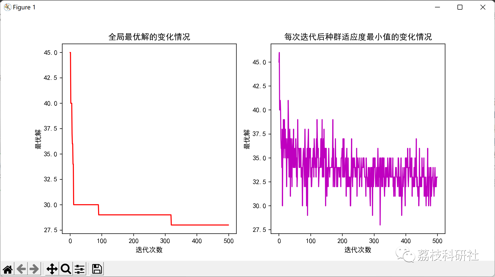

# Path Planning Problem Based on Improved Particle Swarm Optimization Algorithm (Python Code Implementation)

💥💥💥💞💞💞💞 Welcome to this blog❤️❤️❤️💥💥💥
🏆 Bloggers' Advantage: 🌞🌞🌞 The content of the blog strives to be rigorous in thought and clear in logic, for the convenience of readers.
⛳️ Mantra: The journey of a hundred miles is half done in the last ninety.
Litchi Research Society
Code Collection: Power System, Intelligent Algorithms and Applications, Neural Network Prediction, Path Planning, Optimized Scheduling, Workshop Scheduling, Image Processing, Signal Processing...
🎁Column Directory Link:
🌈🌈🌈🌟🌟🌟Electrical Code Intelligent Algorithm and Its Application Path Planning Neural Network Predictive Optimization Scheduling Image Processing Workshop Scheduling Signal Processing Romantic Her My Philosophical Thoughts Math Modeling Complete Code Matters
💥1 Overview
Path planning is the problem of searching for a collision-free path from an initial point to a target point in a complex obstacle environment. Robot path planning is the rational decision-making for the robot's travel route. For known map environments, the Particle Swarm Optimization (PSO) algorithm is an optimization algorithm that simulates bird flight. It has the advantages of fast convergence and easy implementation. Genetic Algorithm (CA) is an algorithm based on the evolution of biological populations, possessing the advantage of global convergence. However, both algorithms have their own limitations: the Particle Swarm Algorithm tends to fall into premature convergence and the Genetic Algorithm has a slower convergence speed. In response to this situation, Literature 2 proposes a hybrid algorithm that combines PSO and GA. The initial population of the hybrid algorithm is generated by PSO. In Literature 3, a PSO algorithm with only GA light flags is proposed, which avoids particles from falling into local optima.
This article is about path planning problems based on improved particle swarm optimization algorithm (Python code implementation).
📚2 Running Results
🎉3 References
[1] Fengshan Lake, Zhang Tingyu, Fengshuo, Zheng Baojuan. Improved Particle Swarm Optimization for Robot Path Planning [J]. Mechanical Design and Manufacturing, 2021(9): 291-294, 298.
Yuan Bin, Wang Weibo, Wang Hui. Multi-objective Point Path Planning Based on Improved Particle Swarm Optimization [J]. Journal of Zhejiang University of Science and Technology, 2022, 34(3): 225-232
🌈4 Python code implementation

Click the article's lower left corner to [read more]

## Images

<!-- PAYMENT_BLOCK -->

## Get this dataset

- Payment link (Stripe): [Buy now](https://buy.stripe.com/3cs8yP7sY87d0vu9AB)
- Payment QR code: 

<!-- /PAYMENT_BLOCK -->
